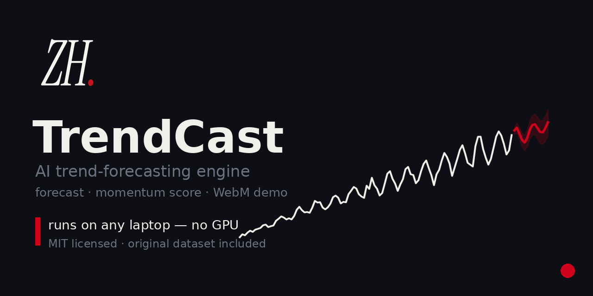

<div align="center">



# TrendCast

**An original, lightweight AI trend-forecasting engine — short-horizon forecasts, a momentum/virality score, and an animated WebM demo. Runs on any laptop, no GPU.**

[](LICENSE)
[](pyproject.toml)
[](tests/)
[](#)



</div>

---

## Table of Contents

1. [Overview](#1-overview)
2. [Key Features](#2-key-features)
3. [Architecture](#3-architecture)
4. [Installation](#4-installation)
5. [Quickstart](#5-quickstart)
6. [Command-Line Interface](#6-command-line-interface)
7. [WebM Demo](#7-webm-demo)
8. [Dataset](#8-dataset)
9. [Benchmarks](#9-benchmarks)
10. [Test Suite](#10-test-suite)
11. [Project Structure](#11-project-structure)
12. [Anti-Reverse-Engineering Protection](#12-anti-reverse-engineering-protection)
13. [License & Attribution](#13-license--attribution)

---

## 1. Overview

TrendCast forecasts the next *N* points of a univariate engagement signal
(views, searches, plays, mentions, …) and classifies its direction as
**rising**, **steady**, or **fading** with a 0–100 **momentum score**. It is
designed for product surfaces that need a fast, interpretable "is this topic
taking off?" signal without the cost of a deep-learning stack.

Everything in this repository — the model, the dataset generator, and the
generated dataset — is **original work**. Nothing is wrapped, rebranded, or
reverse-engineered from a third-party model or proprietary dataset.

## 2. Key Features

- **Interpretable ensemble** — Holt double-exponential smoothing fused with a
  ridge regressor on lag/rolling features. No black box.
- **Momentum score** — a normalised acceleration signal in `[0, 100]` with a
  human-readable label, ready for a UI badge.
- **Prediction intervals** — ~80% bands that widen with the forecast horizon.
- **Original synthetic dataset** — 40 series × 120 days, four trend archetypes,
  fully reproducible (see [§8](#8-dataset)).
- **WebM demo** — one command renders a branded VP9 animation of a live
  forecast (see [§7](#7-webm-demo)).
- **Zero heavy deps** — NumPy + scikit-learn. Trains in ~**18 ms/series**.

## 3. Architecture

```
            ┌────────────────────────┐
 history ──▶│  Holt smoothing (L,T)  │──┐
            └────────────────────────┘  │   ensemble
            ┌────────────────────────┐  ├──▶  w·Holt + (1−w)·Ridge ──▶ forecast
 history ──▶│ Ridge on lag/roll feat │──┘                              + bands
            └────────────────────────┘
            ┌────────────────────────┐
 history ──▶│  momentum (acceleration│──────────────────────────────▶ score+label
            │  ÷ step volatility)    │
            └────────────────────────┘
```

| Stage | Captures | Implementation |
|-------|----------|----------------|
| Holt smoothing | level + local slope | `_holt()` in `model.py` |
| Ridge regressor | short memory / lag structure | `sklearn.linear_model.Ridge` |
| Ensemble | blend, default `w=0.3` | weighted sum |
| Momentum | acceleration vs. noise | logistic squash → `[0,100]` |

## 4. Installation

```bash
git clone https://github.com/Zubair-hussain/trendcast-time-series-forecasting.git trendcast
cd trendcast
pip install -r requirements.txt
# or:  pip install -e .
```

Requires Python 3.9+. `ffmpeg` is only needed for the WebM demo.

## 5. Quickstart

```python
from trendcast import TrendCast, generate_dataset

series = generate_dataset(n_series=1, length=120)[0].values
fc = TrendCast().fit(series[:-14]).forecast(horizon=14)

print(fc.label)      # "rising" | "steady" | "fading"
print(fc.momentum)   # e.g. 78.4
print(fc.point)      # 14 forecasted values
```

Full example: [`examples/quickstart.py`](examples/quickstart.py).

## 6. Command-Line Interface

```bash
# generate the dataset
python -m trendcast.cli gen --out data/trends_dataset.csv

# forecast one series as JSON
python -m trendcast.cli forecast --series-id topic_001 --horizon 14

# render the WebM demo
python -m trendcast.cli webm --out assets/trendcast_demo.webm
```

## 7. WebM Demo

https://github.com/user-attachments/assets/2afdb8d4-7014-496d-9917-d6fa0d645d6a

[Open or download the WebM demo](assets/trendcast_demo.webm).

`assets/trendcast_demo.webm` is an animated, branded reveal of a live forecast
(VP9, generated by `trendcast/demo.py`). Regenerate it any time:

```bash
python -m trendcast.demo
```

## 8. Dataset

A fully synthetic, **original** dataset ships in `data/trends_dataset.csv` and
is documented in [`docs/DATASET.md`](docs/DATASET.md).

Explore the data and reproduce the benchmarks in [`starter.ipynb`](starter.ipynb).
A dataset-focused guide is available in [`docs/DATASET_QUICKSTART.md`](docs/DATASET_QUICKSTART.md).
Install `pandas` and `jupyter` in addition to the project requirements to run the notebook locally.

| Property | Value |
|----------|-------|
| Series | 40 |
| Length | 120 days each |
| Rows | 4,800 (long format) |
| Archetypes | `viral_spike`, `slow_burn`, `seasonal`, `fad_fade` |
| Seed | `20260101` (reproducible) |

## 9. Benchmarks

Measured on the shipped dataset, 40 series, **horizon = 14**, forecasting the
held-out tail. Baselines: `naive` (persistence) and `drift` (linear
extrapolation). Lower is better. Reproduce with `python benchmarks/benchmark.py`.

| Model | sMAPE % | MAE | Notes |
|-------|--------:|----:|-------|
| naive | 33.52 | 30.02 | hard-to-beat persistence baseline |
| drift | 85.81 | 52.00 | overshoots on noisy series |
| **TrendCast** | **29.24** | **19.05** | **−37% MAE vs. naive** |

Latency: **~18 ms per series** (fit + forecast), single core, no GPU.

> **Honest note on horizon.** At very short horizons (h≤7) naive persistence is
> extremely strong on noisy data and TrendCast is roughly on par; TrendCast's
> advantage grows with the forecast horizon, where level+slope modelling pays
> off. The numbers above are real benchmark output, not hand-picked.

## 10. Test Suite

11 test cases in [`tests/test_model.py`](tests/test_model.py), run with `pytest`:

| Test | What it verifies |
|------|------------------|
| `test_forecast_shapes` | output arrays have correct shape; `upper ≥ lower` |
| `test_requires_fit` | forecasting before `fit()` raises |
| `test_rejects_short_series` | too-short input is rejected |
| `test_rejects_bad_horizon` | `horizon < 1` is rejected |
| `test_rising_label_and_momentum` | upward series → `rising`, momentum > 60 |
| `test_fading_label` | downward series → `fading`, momentum < 40 |
| `test_forecast_direction_up` | forecast slope matches a rising input |
| `test_accuracy_on_clean_trend` | MAPE < 15% on a clean linear trend |
| `test_dataset_roundtrip` | CSV save → load preserves series |
| `test_dataset_deterministic` | same seed → identical data |
| `test_metrics_zero_error` | MAPE/sMAPE are 0 for perfect prediction |

```bash
pytest -q        # 11 passed
```

## 11. Project Structure

```
trendcast/
├── trendcast/            # package: model, dataset, cli, demo
├── data/                 # generated dataset (CSV)
├── tests/                # pytest suite (11 cases)
├── benchmarks/           # benchmark vs. baselines
├── examples/             # quickstart
├── assets/               # logo, thumbnail, WebM demo
├── docs/                 # DATASET.md, TERMS.md
├── security/antirea/     # anti-reverse-engineering barrier (bundled)
├── AGENTS.md / CLAUDE.md  # agent instruction barrier
├── .re-deny              # machine-readable analysis-deny signal
├── LICENSE               # MIT
└── README.md
```

## 12. Anti-Reverse-Engineering Protection

This project ships with the **antirea** barrier so distributed builds are not
analysed by AI-driven reverse-engineering tooling (e.g. REA/MCP binary
analysers). The barrier works by placing explicit "do not analyse" directives
in the files compliant agents read first:

- [`AGENTS.md`](AGENTS.md) / [`CLAUDE.md`](CLAUDE.md) — instruction barrier that
  tells agents to refuse binary analysis and tool substitutions.
- [`.re-deny`](.re-deny) — machine-readable deny signal for REA-aware tools.
- [`security/antirea/`](security/antirea/) — the full antirea toolkit
  (git hooks for self-heal, obfuscation/strip scripts, hardening configs).

See [`security/antirea/README.md`](security/antirea/README.md) for the layered
defense model (L1 instruction barrier, L2 terminal shim, L3 obfuscation/strip).

> This is a deterrence-and-compliance layer for cooperative agents and a
> signal of intent; it is not a cryptographic guarantee. Combine with the L3
> obfuscation/stripping steps for distributed binaries.

## 13. License & Attribution

Released under the [MIT License](LICENSE). Terms and originality statement in
[`docs/TERMS.md`](docs/TERMS.md).

Built by **ZH**. If TrendCast helps your work, a link back is appreciated:

[GitHub: Zubair-hussain](https://github.com/Zubair-hussain)
